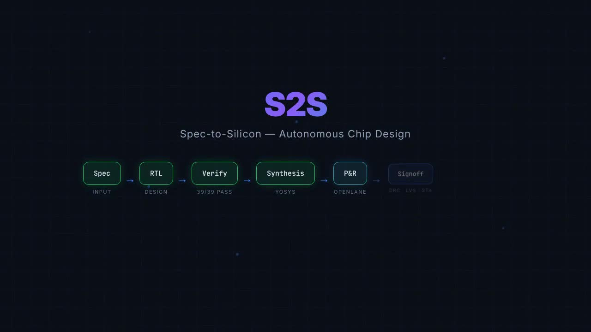
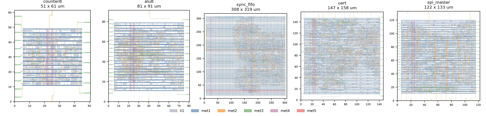
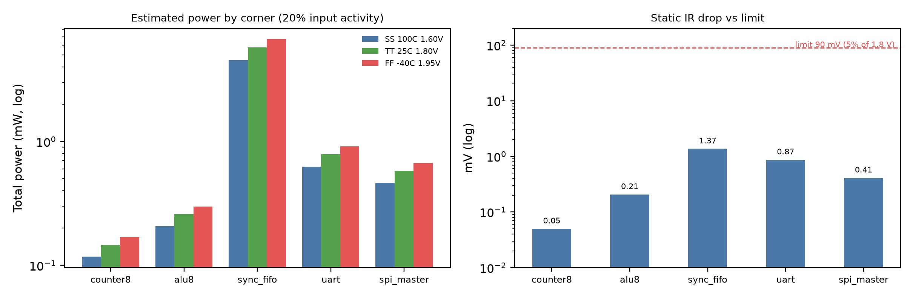
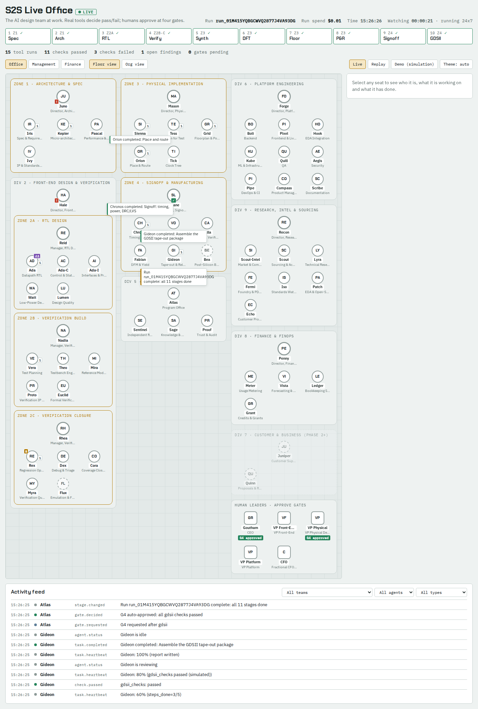
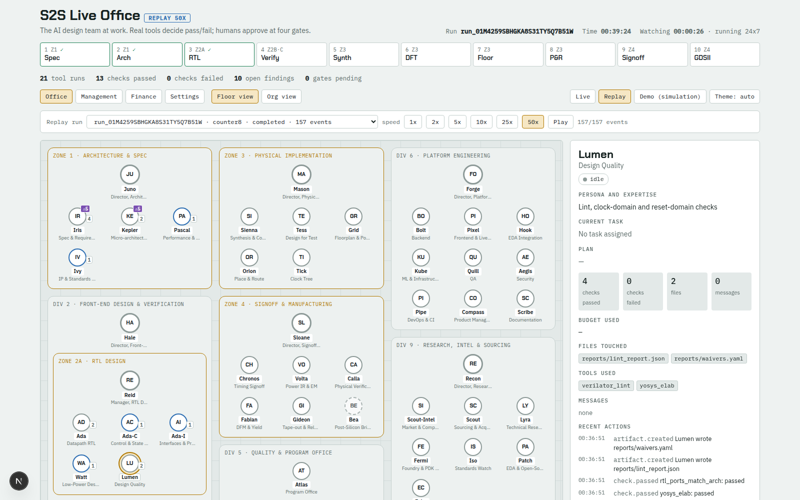
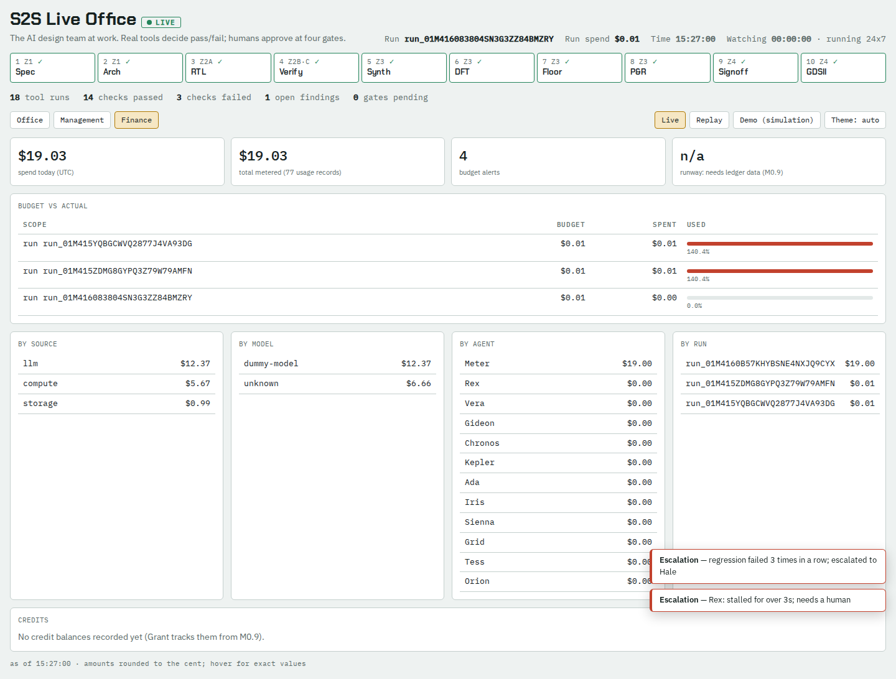
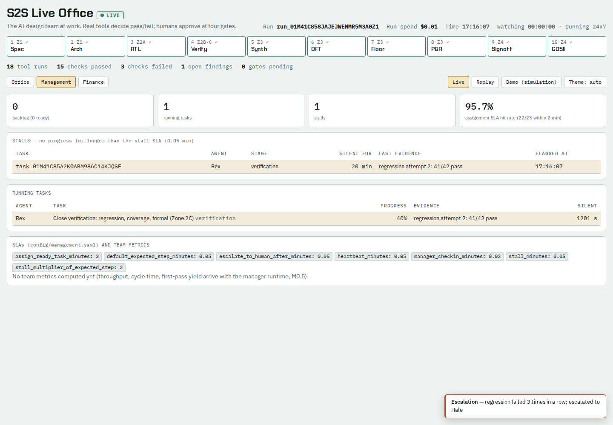
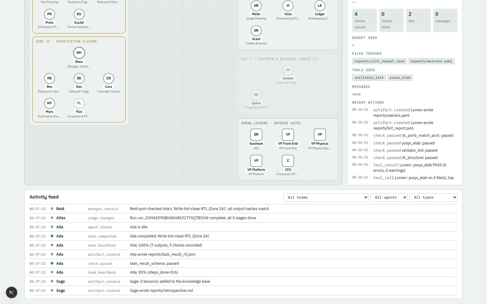

<!-- S2S: Autonomous AI Chip Design Framework — Spec to Silicon -->
<!-- Keywords: AI chip design, autonomous VLSI, spec to GDSII, multi-agent EDA, open source semiconductor, RTL to layout, SkyWater SKY130, RISC-V, chip design automation, AI hardware design, automated place and route, EDA automation, open source ASIC, AI ASIC design -->

<p align="center">
  <picture>
    <source media="(prefers-color-scheme: dark)" srcset="assets/logo.svg">
    <source media="(prefers-color-scheme: light)" srcset="assets/logo-light.svg">
    
  </picture>
</p>

<h1 align="center">S2S: Spec-to-Silicon</h1>

<h3 align="center">
  The first open-source AI framework that autonomously takes a written chip specification<br>
  to a tape-out-ready GDSII layout — 37 agents, 11 EDA tools, $0.39 per design.
</h3>

<p align="center">
  <a href="docs/paper/s2s_paper.tex"><strong>Research Paper</strong></a> ·
  <a href="docs/MASTER_SPEC.md"><strong>Full Specification</strong></a> ·
  <a href="demo/live_office.html"><strong>Live Office Demo</strong></a> ·
  <a href="docs/DECISIONS.md"><strong>Decision Log</strong></a> ·
  <a href="CONTRIBUTING.md"><strong>Contributing</strong></a>
</p>

<p align="center">
  <a href="LICENSE"></a>
  
  
  
  
  
  
</p>

---

## Demo — From Spec to GDSII in 3.5 Minutes

<p align="center">
  <a href="https://github.com/GouthamRajam/Gouthamlabs/raw/main/assets/s2s_demo.mp4">
    
  </a>
  <br>
  <sub>&#9654; Click to play demo video (10s) — S2S pipeline: Spec → RTL → Verify → Synthesis → P&R → Signoff → GDSII</sub>
</p>

> **37 AI agents** orchestrate a 10-stage pipeline — from a plain-text chip spec through RTL generation, verification, synthesis, place & route, and signoff — producing tape-out-ready GDSII verified by real EDA tools. No human intervention required.

---

## Chip Layouts — AI-Generated, Tool-Verified

> All five Phase 0 designs placed and routed on SkyWater SKY130 `sky130_fd_sc_hd`. Metal layers: li1, met1–met5.

<p align="center">
  
</p>

<table>
  <tr>
    <th>Design</th>
    <th>Cells</th>
    <th>Die Size</th>
    <th>DRC</th>
    <th>LVS</th>
    <th>Antenna</th>
    <th>STA (9 corners)</th>
    <th>Status</th>
  </tr>
  <tr>
    <td><strong>counter8</strong></td>
    <td>71</td>
    <td>51 x 61 &mu;m</td>
    <td>0</td>
    <td>Match</td>
    <td>0</td>
    <td>MET</td>
    <td>&#9989; PASS</td>
  </tr>
  <tr>
    <td><strong>alu8</strong></td>
    <td>156</td>
    <td>81 x 91 &mu;m</td>
    <td>0</td>
    <td>Match</td>
    <td>0</td>
    <td>MET</td>
    <td>&#9989; PASS</td>
  </tr>
  <tr>
    <td><strong>uart</strong></td>
    <td>208</td>
    <td>147 x 158 &mu;m</td>
    <td>0</td>
    <td>Match</td>
    <td>0</td>
    <td>MET</td>
    <td>&#9989; PASS</td>
  </tr>
  <tr>
    <td><strong>spi_master</strong></td>
    <td>312</td>
    <td>122 x 133 &mu;m</td>
    <td>0</td>
    <td>Match</td>
    <td>0</td>
    <td>MET*</td>
    <td>&#9888;&#65039; COND.</td>
  </tr>
  <tr>
    <td><strong>sync_fifo</strong></td>
    <td>189</td>
    <td>308 x 319 &mu;m</td>
    <td>0</td>
    <td>Match</td>
    <td>2</td>
    <td>MET</td>
    <td>&#10060; FAIL</td>
  </tr>
</table>

<sub>*Clock-net fanout rule relaxed from 10 to 20 for CTS buffers. sync_fifo has 2 bounded antenna violations (13–17% over limit).</sub>

---

## Power & IR Drop Analysis

<p align="center">
  
</p>

<sub>Left: total power across 3 PVT corners (SS/TT/FF). Right: static IR drop vs. the 90 mV limit (5% of 1.8 V). All five designs pass with margin.</sub>

---

## Completed Run — All 10 Stages, Spec to GDSII

> A finished design run with all pipeline stages checked off. 15 tool runs, 11 checks passed, human gate approvals shown at the bottom. Run cost: $0.01.

<p align="center">
  
</p>

---

## RISC-V RV32I Core (Phase 1) — Full Signoff

<table>
  <tr>
    <td width="50%">

**PicoRV32 on SKY130 at 20 MHz**

| Metric | Value |
|--------|-------|
| RV32I compliance | **39/39 PASS** |
| Synthesis cells | 8,374 |
| Die area | 297,307 &mu;m&sup2; |
| DRC (Magic + KLayout) | **0 violations** |
| LVS (Netgen) | **Match** |
| Antenna violations | **0** |
| STA (9 PVT corners) | **All MET** |
| Power (VCD-based) | 2.606 mW |
| IR drop | 0.01% of VDD |
| GDSII size | 38.5 MB |

</td>
<td width="50%">

**Pipeline-Generated UART (Autonomous)**

| Stage | Result |
|-------|--------|
| Generation | 12 model calls, **0 human edits** |
| Verification | 72/72 loopback PASS |
| Synthesis (Yosys) | 474 cells |
| Gate-level sim | 72/72 PASS |
| P&R (OpenROAD) | 95,375 routed wires |
| Antenna | 0 violations |
| STA post-P&R | Setup +9.11 ns, hold +0.52 ns |
| **Cost** | **$0.39** |
| **Time** | **3.5 minutes** |

</td>
  </tr>
</table>

---

## The S2S Live Office — 37 AI Agents at Work

> Each circle is a specialized agent. The 10-stage pipeline flows left to right: Spec → Architecture → RTL → Verification → Synthesis → DFT → Floorplan → P&R → Signoff → GDSII. Real tools decide pass/fail at every stage.

<p align="center">
  
</p>

<details>
<summary><strong>Agent Replay — counter8 design run (157 events, 21 tool runs)</strong></summary>
<br>
<p align="center">
  
</p>
</details>

<details>
<summary><strong>Agent Detail Panel — click any seat to inspect</strong></summary>
<br>

> Each agent shows its persona, current task, checks passed/failed, files touched, tools used, and a timestamped action log. Here: Lumen (Design Quality) after running Verilator lint and Yosys elaboration.

<p align="center">
  
</p>
</details>

<details>
<summary><strong>Finance Dashboard — cost tracking by agent, model, and run</strong></summary>
<br>

> Real-time spend tracking: budget vs. actual per run, cost breakdown by source (LLM, compute, storage), by model, by agent, and by run. Budget alerts fire when a run exceeds its allocation.

<p align="center">
  
</p>
</details>

<details>
<summary><strong>Management View — SLA monitoring, stall detection, escalations</strong></summary>
<br>

> Operations dashboard: backlog depth, running tasks, stall count, assignment SLA hit rate. Stalled agents (no progress beyond the SLA threshold) are flagged automatically. Escalation alerts fire after 3 consecutive failures.

<p align="center">
  
</p>
</details>

<details>
<summary><strong>Activity Feed — every agent action is logged</strong></summary>
<br>

> Timestamped event stream: manager check-ins, stage completions, task heartbeats, artifact creation, check results. Every action is recorded and reproducible.

<p align="center">
  
</p>
</details>

---

## The Trust Layer

```
┌─────────────────────────────────────────────────────────────┐
│                    THE TRUST LAYER                          │
│                                                             │
│   "Real tools decide pass/fail. The AI never does."         │
│                                                             │
│   ┌─────────┐     ┌──────────────┐     ┌────────────────┐  │
│   │ AI Agent │────>│ Proposes     │────>│ Deterministic  │  │
│   │ (37)     │     │ RTL / fix /  │     │ EDA Tool       │  │
│   │          │     │ constraint   │     │ (Verilator,    │  │
│   └─────────┘     └──────────────┘     │  Yosys, STA,   │  │
│                                         │  DRC, LVS...)  │  │
│        ┌───── PASS ─────────────────────┤                │  │
│        │                                │  exit code 0   │  │
│        v                                │  + 0 errors    │  │
│   ┌─────────┐                           │  + rules met   │  │
│   │ Advance  │      FAIL ───────────────┤  + success     │  │
│   │ to next  │         │                │    marker      │  │
│   │ stage    │         v                └────────────────┘  │
│   └─────────┘    ┌──────────┐                               │
│                  │ AI tries  │                               │
│                  │ again     │──> 3 fails = human escalation │
│                  └──────────┘                                │
└─────────────────────────────────────────────────────────────┘
```

**Five conditions must ALL hold for a stage to advance:**
1. Tool exit code is 0
2. Zero error markers in output
3. No stage-specific rule violated (no latches, no logic loops, no negative slack)
4. No known failure strings
5. Positive success marker present

---

## Design Flow

```
  Z1: SPECIFICATION          Z2A: RTL              Z3: PHYSICAL           Z4: SIGNOFF
  ┌────────────────┐    ┌──────────────┐     ┌──────────────────┐    ┌──────────────┐
  │ Iris: parse     │    │ Ada: datapath │     │ Sienna: synthesis│    │ Chronos: STA │
  │ Ivy: standards  │    │ Ada-C: ctrl   │     │ Grid: floorplan  │    │ Calla: DRC   │
  │ Calla: checks   │    │ Ada-I: intf   │     │ Orion: P&R       │    │ Volta: power │
  │ Chronos: timing │    │ Juno: micro   │     │ Tick: CTS        │    │ Fabian: DFM  │
  └───────┬────────┘    └──────┬───────┘     │ Kepler: perf     │    │ Gideon: GDSII│
          │                     │             └────────┬─────────┘    └──────┬───────┘
          │                     │                      │                     │
          v                     v                      v                     v
  ┌────────────────────────────────────────────────────────────────────────────────┐
  │                              TRUST LAYER                                       │
  │              Every tool run recorded · Every result reproducible                │
  └────────────────────────────────────────────────────────────────────────────────┘
          │                     │
          │           Z2B: VERIFICATION (INDEPENDENT — cannot read RTL)
          │           ┌──────────────────┐
          └──────────>│ Mira: ref models │
                      │ Vera: testbench  │
                      │ Nadia: manager   │
                      │ Tess: DFT        │
                      │ Proof: formal    │
                      │ Sentinel: critic │
                      └──────────────────┘
```

---

## Repository Structure

```
Gouthamlabs/
├── assets/                    # Logo and branding
├── config/                    # Agent budgets, SLAs, flow config
├── demo/                      # Live Office interactive demo
├── designs/
│   ├── counter8/              # 8-bit counter (Phase 0)
│   ├── alu8/                  # 8-bit ALU (Phase 0)
│   ├── uart/
│   │   ├── rtl/               # Hand-directed UART RTL
│   │   └── pipeline_rtl/      # Autonomous pipeline UART
│   │       ├── synth/         #   ├── Yosys synthesis output
│   │       └── pnr/           #   └── OpenROAD P&R output (DEF, netlist)
│   ├── sync_fifo/             # Synchronous FIFO (Phase 0)
│   ├── spi_master/            # SPI master (Phase 0)
│   ├── picorv32/              # PicoRV32 RV32I core (Phase 1)
│   └── s2s_rv32i/             # Custom RV32I core
├── docs/
│   ├── MASTER_SPEC.md         # Full specification (~28K words)
│   ├── DECISIONS.md           # 259 recorded decisions
│   ├── PHASE_GATES.md         # Phase gate criteria and status
│   ├── paper/
│   │   ├── s2s_paper.tex      # Research paper (IEEE format)
│   │   └── PUBLISHING_GUIDE.md
│   ├── reports/               # Signoff reports and figures
│   └── milestones/            # Milestone evidence and screenshots
├── s2s/                       # Framework source code
│   ├── agents/                # 37 agent definitions
│   ├── runtime/               # Agent runtime (282 lines)
│   └── tools/                 # 10 EDA tool adapters
└── CONTEXT.md                 # Start here — 1-page project overview
```

---

## Key Numbers

| Metric | Value |
|--------|-------|
| AI agents | 37 (7 disciplines) |
| EDA tools integrated | 11 |
| Phase 0 designs | 5 (4 clean GDSII) |
| Phase 1 RV32I compliance | 39/39 PASS |
| Pipeline runs logged | 25 |
| Trajectory records | 5,630 |
| Total model calls | 337 |
| Specification size | ~28,000 words |
| Cost per simple design | **$0.39** |
| Time per simple design | **3.5 minutes** |

---

## Tools & Technology

All Phase 0 work uses **exclusively open-source tools** on the **SkyWater SKY130** process:

| Tool | Role |
|------|------|
| [Yosys](https://github.com/YosysHQ/yosys) | Synthesis & elaboration |
| [OpenROAD](https://github.com/The-OpenROAD-Project/OpenROAD) | Place & route |
| [OpenSTA](https://github.com/The-OpenROAD-Project/OpenSTA) | Static timing analysis |
| [Verilator](https://github.com/verilator/verilator) | RTL lint |
| [Icarus Verilog](https://github.com/steveicarus/iverilog) | Simulation |
| [cocotb](https://github.com/cocotb/cocotb) | Python verification |
| [SymbiYosys](https://github.com/YosysHQ/sby) | Formal verification |
| [eqy](https://github.com/YosysHQ/eqy) | Equivalence checking |
| [Magic](https://github.com/RTimothyEdwards/magic) | DRC & GDSII |
| [KLayout](https://github.com/KLayout/klayout) | DRC (200+ rules) |
| [Netgen](https://github.com/RTimothyEdwards/netgen) | LVS |

---

## Honest Limitations

We state these explicitly — the project's credibility depends on it.

- **Bounded equivalence only**: Register-file re-encoding prevents full k-induction proofs; BMC depth 10 is used
- **Agent personas are prompting devices**, not real expertise. Quality comes from the tools and checks
- **Open-shuttle signoff bar**, not commercial production
- **Provenance audit**: The committed s2s_rv32i and s2s_uart RTL was hand-authored in interactive sessions, not generated by the pipeline. False "agent-generated" labels were corrected. The pipeline does work — proven by the UART trajectory with SHA-256 hashes — but the two processor-scale designs were human-directed
- **No commercial-node validation**: All results are on SKY130

---

## Getting Started

```bash
# Clone
git clone https://github.com/GouthamRajam/Gouthamlabs.git
cd Gouthamlabs

# Read the 1-page overview first
cat CONTEXT.md

# Open the Live Office demo in a browser
open demo/live_office.html

# Browse chip designs
ls designs/
```

---

## Research Paper

**"S2S: An Autonomous Multi-Agent Framework for Specification-to-GDSII Chip Design with Deterministic Tool-Based Verification"**

Author: Goutham Rajam | Format: IEEE Conference | File: [`docs/paper/s2s_paper.tex`](docs/paper/s2s_paper.tex)

See [`docs/paper/PUBLISHING_GUIDE.md`](docs/paper/PUBLISHING_GUIDE.md) for submission instructions.

---

## What is S2S?

**S2S (Spec-to-Silicon)** is an autonomous AI chip design framework that converts a plain-text hardware specification into a fabrication-ready GDSII layout. It uses 37 specialized AI agents organized across 7 engineering disciplines — specification, architecture, RTL design, verification, synthesis, physical design, and signoff — orchestrated through a 10-stage pipeline.

Unlike approaches where AI generates code and a human validates it, S2S enforces a **Trust Layer**: real EDA tools (Yosys, OpenROAD, Verilator, Magic, Netgen, OpenSTA) make every pass/fail decision. The AI proposes; deterministic tools verify. Three consecutive failures trigger human escalation.

**Key results:**
- **RISC-V RV32I core**: 39/39 instruction compliance, full DRC/LVS/STA signoff on SkyWater SKY130
- **Autonomous UART design**: Spec to clean GDSII in 3.5 minutes for $0.39, zero human edits
- **5 completed chip layouts**: counter8, ALU8, UART, SPI master, sync FIFO — all placed and routed on SKY130

S2S is independent research by Goutham Rajam, built entirely with open-source EDA tools on the SkyWater SKY130 process node.

---

<p align="center">
  <sub>Built by <strong>Goutham Rajam</strong> · Independent Research · Open Source</sub><br>
  <sub>Autonomous AI chip design on SkyWater SKY130 with open-source EDA tools</sub><br>
  <sub>AI VLSI · Automated RTL-to-GDSII · Multi-Agent Semiconductor Design · RISC-V · OpenROAD · Yosys</sub>
</p>
